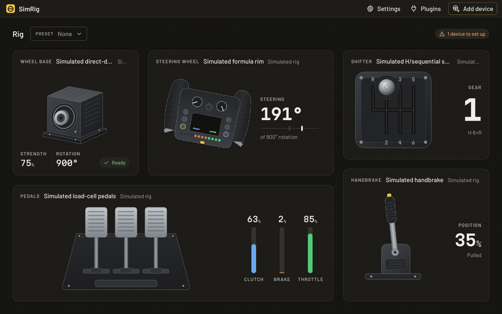

# SimRig

**Set up your sim-racing rig on Linux, whatever the brand.** Wheel base, steering wheel, pedals,
shifter and handbrake in one app: SimRig installs the drivers your devices need, shows every
device moving live, lets you tune and calibrate them and save presets, then gets out of the way.
Your devices keep working in every game with SimRig closed.

**Website: [adiakys.github.io/SimRig](https://adiakys.github.io/SimRig/)**, with every supported
device brand by brand, how to install, and the questions people ask.



- **Plug in, see it move.** Every device is drawn as it stands on your rig and moves as you
  use it: the wheel turns, the gear engages, the handbrake pulls.
- **Drivers without the terminal.** When a device needs a driver, SimRig installs it (one
  password) and it keeps working with the app closed, after updates and reboots.
- **Any mix of brands.** A base from one brand, pedals from another, a no-name USB shifter:
  they all sit in the same rig.
- **No root, no background process.** SimRig runs as you, asks for the password only to install
  a driver, and leaves nothing running when you close it.
- **Honest about your hardware.** What a device or its driver cannot do is shown greyed out
  with the reason, never hidden.
- **Works here, not in the game?** SimRig checks what games need from each device (access,
  the right kernel driver, Steam Input) and says what is wrong and how to fix it.

> **Early development.** SimRig works, but most devices have not been tested on real hardware
> yet: see the table below. Have a Moza, Logitech, Thrustmaster, PXN or another wheel? See the
> [call for testers](https://github.com/Adiakys/SimRig/discussions/1), try it and
> [tell how it went](https://github.com/Adiakys/SimRig/issues/new?template=hardware-report.yml):
> about 15 minutes, and it moves your device from "Untested" to tested for everyone.

## Supported devices

| Brand | Devices | Driver | Status |
|---|---|---|---|
| **Fanatec** | Wheel bases: CSL DD / GT DD Pro / ClubSport DD, CSL Elite, ClubSport V2 and V2.5, Podium DD1 and DD2, CSR Elite, Porsche 911 Turbo S. Their steering wheels. Pedals on the base, CSL Elite and CSL load cell pedals, ClubSport V3 | [hid-fanatecff](https://github.com/gotzl/hid-fanatecff), installed by SimRig (or yours, if you have it) | **Partial**: tested on a CSL DD (live inputs, rotation, tuning menu); other models untested |
| **Any USB device** | Shifters (H-pattern, sequential) and handbrakes without a brand, or whose descriptor is useless (even those the kernel rejects): mapped by moving them | SimRig's generic USB driver | **Full**: tested on an H-pattern shifter and a handbrake |
| **Moza** | Wheel bases R3 to R21 (rotation, force feedback, base settings), pedals on the base, SR-P and CRP pedals, HBP handbrake, SGP sequential and HGP H-pattern shifters, on their own USB or plugged into the base. The steering wheel on the base: its controls, paddle mode, LED brightness, encoder and stick modes (untested) | [hid-universal-pidff](https://github.com/JacKeTUs/universal-pidff), in the kernel from 6.15 (built by SimRig on older kernels); settings over the serial port, with the protocol worked out by [Boxflat](https://github.com/Lawstorant/boxflat) | **Partial**: tested on an R21 Ultra base (live inputs, rotation, force feedback, settings), CRP2 pedals, an HBP handbrake and an SGP shifter (live inputs); other models untested |
| **Logitech** | G29, G27, G25, Driving Force GT/Pro, MOMO, G923 (PlayStation and Xbox), G920, G PRO, RS50: rotation, force feedback settings, pedals on the wheel. The G29 family: the model presented to older games, combined pedals. WingMan Formula GP and Formula Force | in the kernel; SimRig adds [new-lg4ff](https://github.com/berarma/new-lg4ff) for the G29 family and the [TrueForce driver](https://github.com/mescon/logitech-trueforce-linux-driver) for the G PRO and RS50, only when one of them is plugged in. TrueForce in games through Proton also needs that project's companion apps (logi-launch), which SimRig does not install. The Xbox editions of the G923 and RS50 are switched to their PC mode at every plug-in, which needs `usb-modeswitch` installed | **Untested** on real hardware (works on simulated devices) |
| **Thrustmaster** | T300 RS (and T-GT II), T248, T128, TX, TS-PC Racer, TS-XW, T150, TMX: rotation, force feedback strength, effect levels, pedals on the base. T500 RS and T80: inputs only (no force feedback driver on Linux). Not the T818 | [hid-tmff2](https://github.com/Kimplul/hid-tmff2), and [hid-t150](https://github.com/scarburato/t150_driver) for the T150 and TMX, installed by SimRig (or yours, if you have them) | **Untested** on real hardware (works on simulated devices) |
| **PXN** | V10, V12, V12 Lite, Lite Star GT987: live inputs and force feedback. VD6, VD4: also rotation, force feedback and base settings (VD4: force feedback from Linux 6.15). Pedals on the base | [hid-universal-pidff](https://github.com/JacKeTUs/universal-pidff), in the kernel from 6.15 (built by SimRig on older kernels); VD settings with the protocol worked out by [Pitwall](https://github.com/unionyxx/pitwall) | **Partial**: tested on a VD4 (live inputs, rotation, base settings, force feedback in games); other models untested |
| **Other wheel bases** | On the standard force feedback protocol: Cammus C5 and C12, Asetek Invicta, Forte, La Prima and Tony Kanaan, VRS DirectForce Pro, FFBeast, Turtle Beach VelocityOne Race, OpenFFBoard: live inputs, force feedback, its strength and centering spring. Rotation and the rest stay in their own software | [hid-universal-pidff](https://github.com/JacKeTUs/universal-pidff), in the kernel from 6.15 (built by SimRig on older kernels); the kernel's own for the OpenFFBoard | **Untested** on real hardware (works on simulated devices) |
| **Simagic** | Wheel bases Alpha Mini, Alpha, Alpha U and the EVO series: rotation, force feedback strength, natural and game effect levels, filter, end stop, ring light; pedals on the base. A firmware older than v159 works with the kernel's driver, without settings. Pedal sets, shifters and handbrakes on their own USB not yet | [simagic-ff](https://github.com/JacKeTUs/simagic-ff), installed by SimRig only for the bases that need it (or yours, if you have it) | **Untested** on real hardware (works on simulated devices) |

**Full**: tested on the hardware · **Partial**: tested on some models or some features ·
**Untested**: works in tests, not tried on real hardware yet · **Planned**: not supported yet

Features depend on the device and its driver: SimRig shows, for every setting, whether your
hardware supports it. A setting marked with a yellow sign works only in part, for example when the
driver takes a value but the device cannot report it back: its tooltip says why.

The drivers are open source projects of their own communities, credited with their licenses in
[THIRD-PARTY.md](THIRD-PARTY.md). A driver you installed yourself is kept as it is: SimRig only
adds its access rules next to it.

## Install

Download the package for your distribution from the
[latest release](https://github.com/Adiakys/SimRig/releases/latest) and install it:

```sh
# Debian, Ubuntu, Linux Mint, Pop!_OS
sudo apt install ./simrig_*_amd64.deb

# Fedora
sudo dnf install ./simrig-*.x86_64.rpm

# openSUSE
sudo zypper install ./simrig-*.x86_64.rpm

# Arch, Manjaro, EndeavourOS
sudo pacman -U ./simrig-*-x86_64.pkg.tar.zst

# Any other distribution
tar xzf simrig-*-x86_64-linux.tar.gz && sudo ./simrig-*-x86_64-linux/install.sh
```

Then open **SimRig** from your applications and follow the first setup: it checks your system,
finds your devices and installs what they need.

**Requirements**: an x86-64 Linux with polkit (`pkexec`). Drivers built for your kernel (like
Fanatec's) also need DKMS, a compiler and your kernel's headers: SimRig tells you what is
missing.

**Updates**: SimRig shows a new release in its top bar and installs it with one click (and
your password). Pre-releases are offered when chosen in Settings.

**Uninstall**: remove the package as usual. The drivers SimRig installed are kept, so your
devices keep working; remove them first from **Plugins** in the app, or afterwards with
`sudo /var/lib/simrig/remove-drivers --all` (on Debian and Ubuntu, `apt purge simrig` does it).

## How it works

SimRig is a client of your drivers, like a game. Each brand is supported by a **plugin** that
knows its devices and, when needed, ships a **driver**: SimRig installs the driver when you add
the device, and the driver does the work, in every game, with SimRig closed. The app only reads
and changes settings through the same interfaces games use, so it never adds latency and never
needs to run in the background.

Settings you change apply at once. **Save as default** stores them in the driver or in the
device, so they come back every time you plug it in. **Presets** save the whole rig and switch
it in one click.

## Contributing

The most useful help right now is a test on your hardware: the
[call for testers](https://github.com/Adiakys/SimRig/discussions/1) lists the devices that need it
and what to try, then a
[hardware report](https://github.com/Adiakys/SimRig/issues/new?template=hardware-report.yml)
tells how it went, even when everything works. Bug reports and plugins for new brands are
welcome too. To build and run SimRig from the sources, see [docs/development.md](docs/development.md); for its design,
[docs/architecture.md](docs/architecture.md).

## License

GPL-3.0-or-later. See [LICENSE](LICENSE). Bundled third-party components (drivers, fonts) keep
their own licenses: see [THIRD-PARTY.md](THIRD-PARTY.md).

Product and brand names (Fanatec, Moza, Logitech, Thrustmaster…) belong to their owners and are
used only to say which hardware SimRig works with. SimRig is not affiliated with, endorsed by or
sponsored by any of them.

## Acknowledgements

Claude Code did a lot of the typing on this project. The direction, design, testing, and
debugging stayed on me.
