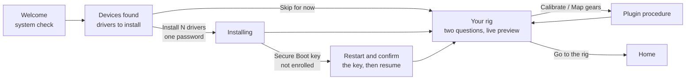
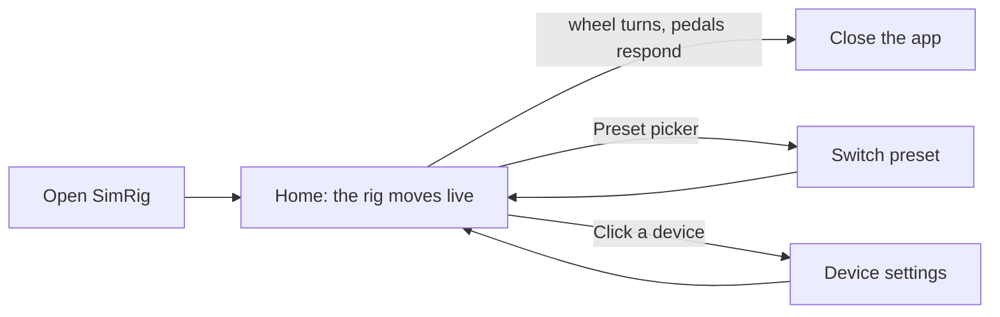
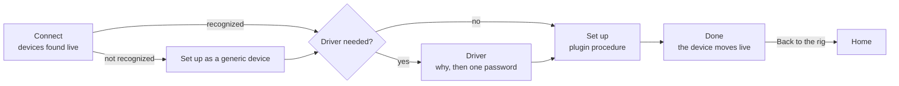
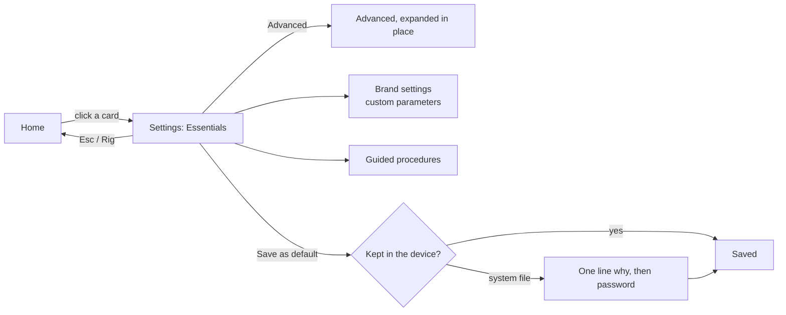

# SimRig: user flows (M1)

How people move through the app. Screens refer to the static mockups in
[`mockups/png`](mockups/png) (each in a `-light` and a `-dark` version); copy in the mockups is
Italian, the UI ships in English and Italian. Visual rules are in [`DESIGN.md`](../../DESIGN.md),
product principles in [`PRODUCT.md`](../../PRODUCT.md).

Every flow follows three rules from PRODUCT.md:

- **Plug in, see it move.** Each flow ends on a live device as soon as possible.
- **Simple by default, deep on demand.** Advanced settings never appear in a beginner's path.
- **The app is a guest.** The password is asked only when something touches the system, always
  after one line saying why.

## 1. First run

When the app starts and no rig has been set up yet.

| Step | Screen | What the user sees and does |
|---|---|---|
| Welcome | `first-1-welcome` | One sentence of promise, the system check (distribution, kernel, Secure Boot, session) as a short list. Problems are explained, never blocking unless they really are (no pkexec: drivers cannot be installed from the app). One action: **Start**. |
| Devices | `first-2-devices` | Every device found, with its picture and state: ready, needs a driver, comes with the base, not recognized. Plugging in more devices adds rows live. One action: **Install N drivers**, a single password for all. |
| Your rig | `first-3-rig` | Only the questions the hardware cannot answer: optional components (pedal inputs of the base when separate pedals are used), clutch present or not. A live preview shows the effect at once. Calibrations and mappings are offered as plugin procedures. One action: **Go to the rig**. |

States: driver install failure (the step shows the error with "Try again" and "Skip"), the
password dialog dismissed (nothing changes, the button stays), Secure Boot enrollment needed
(the flow resumes at "Your rig" on the next start).

## 2. Daily use

The most frequent flow: a glance before driving.

- **Home** (`home`): one card per device, placed like the real rig, each moving live with one big
  value. The rig header holds the preset picker (one click) and the overall state.
- **Switch preset**: choosing a preset applies its values and saves them in the drivers; the
  header confirms ("Applied and saved in the drivers"). Values a device cannot keep are applied
  for the session and flagged.
- **Nothing to do** is a success: the user looks, sees everything moving, closes the app.

States: a device unplugged (its card fades to the generic drawing with "Disconnected", it comes
back by itself when plugged in), a plugin that failed (its cards show "Not responding" with
**Restart**), a component excluded from the rig (not shown on the home, listed in Settings).

## 3. Add a device

From **Add device** in the top bar, or when an unknown device is plugged in while the app is open
(a discreet prompt in the rig header, never a modal).

| Step | Screen | Notes |
|---|---|---|
| Connect | `add-1-connect` | Listening state; devices appear as they are plugged in. Unknown devices offer **Set up as generic** (the generic USB plugin), never automatically. |
| Driver | `add-2-driver` | What will be installed and the three promises (works with the app closed, starts only with the device, removable). The password line sits right above **Install the driver**. Skipped when the driver is already there or provided by the system. |
| Set up | `add-3-setup` | A procedure defined by the plugin, rendered generically: here mapping the gears of a 6+R shifter, advancing by itself as each gear is detected. The drawing follows the configuration (6+R or 7+R). |
| Done | `add-4-done` | The device moving live, the state saved in the driver, **Back to the rig** (primary) and **Open settings**. |

States: no device appears after a while (help: cable, port, permissions, "it is a hub"), the
procedure fails or is cancelled (back to the previous step, nothing saved), the driver needs a
reboot (Done says so and the device appears after the restart).

## 4. Tune a component

From a device card on the home.

- **Settings** (`component`): the live device on the left (it travels there from the home), the
  settings on the right: **Essentials** first (three or four controls), **Advanced** collapsed,
  then the plugin's brand settings, then the plugin's guided procedures.
- Changes apply live, without privileges. Each control says how long it lasts ("Saved in the
  base", "Restored when plugged in", "Until unplugged").
- Unsupported items stay in place, disabled, with the reason under their label.
- Effects that move the wheel ask for confirmation first ("The wheel moves by itself: hold it").

For the shifter, the layout is a segmented **6+R / 7+R** with the reverse position; the drawing
updates immediately. For the pedals, the clutch appears only when the component declares it.

## 5. Plugins and drivers

From **Plugins** in the top bar.

- List of installed plugins with their origin (official or third party), version and state.
- For each plugin: its driver state (installed, provided by the system, needs a reboot, user access
  missing), with **Install**, **Update** or **Remove**, each privileged action with its password
  line.
- Removing a driver says what stops working.

## 6. General settings

From **Settings** in the top bar.

- Theme (system, light, dark), language, units (degrees, percent), reduced motion.
- Rig composition: excluded components (with **Include again**), devices added from the catalog
  before plugging them in.
- Devices: for each USB device, the plugin that handles it (**Automatic**, or one of the plugins
  that can) and the procedures its plugin offers on it (set up again, forget the setup).
- Presets: list, rename, import, export, delete.
- Uninstall: the dialog that offers to remove the drivers too (see architecture §6.5).

## Screens produced

| Mockup | Flow |
|---|---|
| `home`, `home-empty` | Daily use, empty rig |
| `component` | Tune a component (wheel base) |
| `add-1-connect`, `add-2-driver`, `add-3-setup`, `add-4-done` | Add a device (generic USB shifter) |
| `first-1-welcome`, `first-2-devices`, `first-3-rig` | First run |
| `style-guide` | Style guide board |

Plugins and General settings are described here and will be designed with the M1 build.
